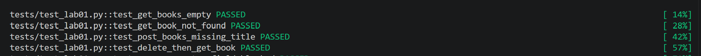

# Lab 1 - Test Books API từ đầu

Dự án thực hành kiểm thử API quản lý sách sử dụng Flask và Pytest[cite: 6].

## 🧪 Các Test Case đã thực hiện (Bước 1)

Dưới đây là mô tả chi tiết về 4 bài kiểm thử chính trong `tests/test_lab01.py`[cite: 6, 7]:

1. **`test_get_books_empty`**[cite: 6, 7]
   * **Mô tả:** Kiểm tra endpoint `GET /books` khi cơ sở dữ liệu đang trống[cite: 6].
   * **Kết quả kỳ vọng:** Phản hồi trả về mã trạng thái `200` và dữ liệu là một mảng rỗng `[]` (không phải `null`)[cite: 6].

2. **`test_get_book_not_found`**[cite: 6, 7]
   * **Mô tả:** Kiểm tra endpoint `GET /books/<id>` với một định danh (ID) không tồn tại trong hệ thống[cite: 6].
   * **Kết quả kỳ vọng:** Phản hồi trả về mã trạng thái `404` kèm theo đối tượng JSON chứa mã lỗi `"code": "NOT_FOUND"`[cite: 6].

3. **`test_post_books_missing_title`**[cite: 6, 7]
   * **Mô tả:** Kiểm tra hành vi của endpoint `POST /books` khi gửi dữ liệu lên nhưng bị thiếu trường bắt buộc là `title`[cite: 6].
   * **Kết quả kỳ vọng:** Phản hồi trả về mã trạng thái `400` và trong phần chi tiết lỗi (`errors`) có chỉ rõ lỗi thiếu trường `title`[cite: 6].

4. **`test_delete_then_get_book`**[cite: 6, 7]
   * **Mô tả:** Kiểm thử kịch bản xóa một cuốn sách theo ID, sau đó thực hiện gọi `GET` lại chính ID đó[cite: 6].
   * **Kết quả kỳ vọng:** Cuốn sách sau khi đã xóa thành công sẽ không còn tồn tại, yêu cầu `GET` tiếp theo phải trả về mã `404`[cite: 6].
