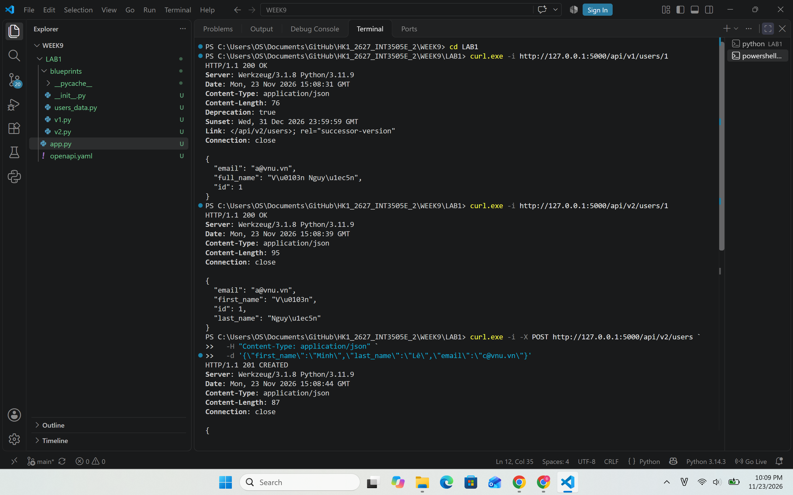
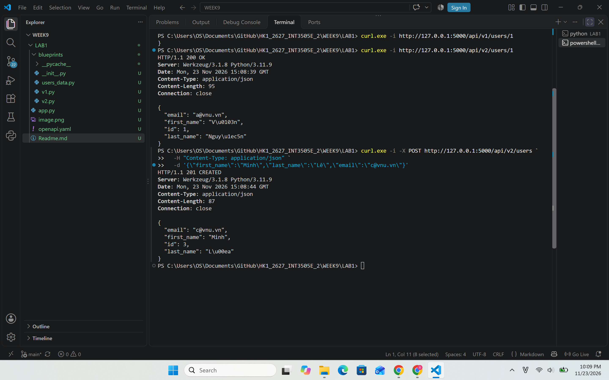

# WEEK 9 - LAB 1: URI Path Versioning (User API v1 → v2)

Triển khai cơ chế **URI Path Versioning** bằng **Flask Blueprint** cho User API với 2 phiên bản chạy song song trên cùng một nguồn dữ liệu (`users_data.py`):
- **v1 (`/api/v1/users/{id}`)**: Trả về trường `full_name` (giữ nguyên tương thích ngược) và gắn các header thông báo ngừng hỗ trợ (`Deprecation`, `Sunset`, `Link`).

- **v2 (`/api/v2/users/{id}`)**: Tách `full_name` thành `first_name` và `last_name` (breaking change), đồng thời mở rộng thêm endpoint `POST /api/v2/users`.

- Tài liệu hóa đặc tả API bằng **OpenAPI 3.0.3** (`openapi.yaml`).

