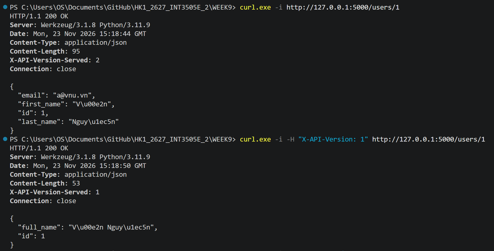
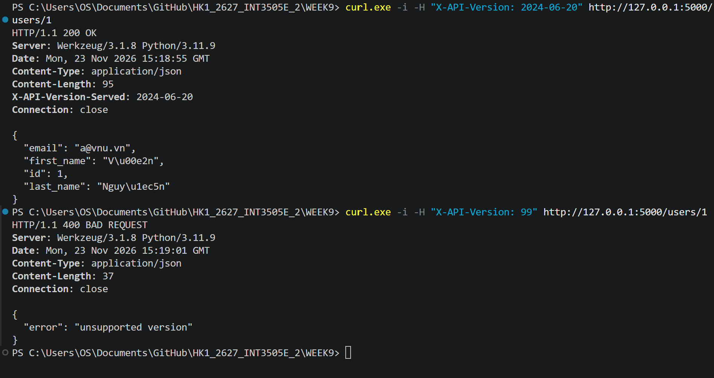

# LAB 2: Header Versioning với Decorator `@api_version`

- Sử dụng cùng một URL `GET /users/<int:uid>` cho cả 3 phiên bản API (`1`, `2`, `2024-06-20`).
- Client chỉ định phiên bản mong muốn thông qua request header `X-API-Version` (nếu không gửi, mặc định dùng phiên bản ổn định mới nhất là `2`).
- Server gắn thêm response header `X-API-Version-Served` để hỗ trợ debug.
- Nếu client gửi phiên bản không nằm trong danh sách hỗ trợ, trả về `400 Bad Request` và không fallback.

