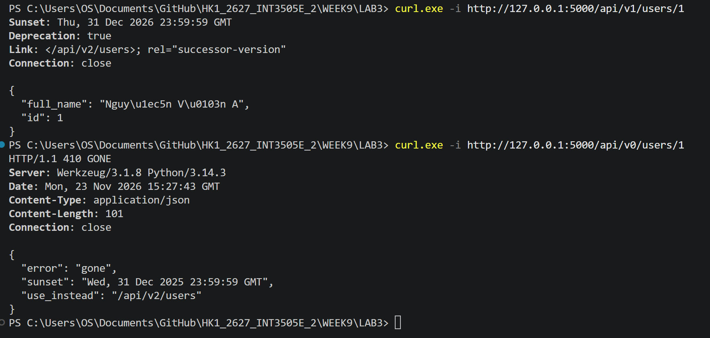

# LAB3 — Sunset Middleware (`@deprecate_at`)

Bài thực hành triển khai cơ chế thông báo ngừng hỗ trợ (API Deprecation & Sunset) bằng Flask decorator theo chuẩn **RFC 8594**.


## 1. Yêu cầu & Cách chạy

### Cài đặt thư viện
```powershell
pip install flask
```

### Khởi chạy server
```powershell
python app.py
```
Server sẽ chạy mặc định tại địa chỉ `http://127.0.0.1:5000`.

## 2. Danh sách Endpoint

| Endpoint | Mốc Sunset (UTC) | Trạng thái kiểm thử |
| :--- | :--- | :--- |
| `GET /api/v1/users/<uid>` | `2026-12-31 23:59:59 GMT` | Trước sunset (`200 OK` + Headers + Log) |
| `GET /api/v0/users/<uid>` | `2025-12-31 23:59:59 GMT` | Sau sunset (`410 Gone`) |

## 5. Kết quả kiểm thử (3 tình huống)

### Tình huống 1: Gọi API trước thời điểm Sunset (`HTTP 200 OK`)
**Lệnh:**
```powershell
curl.exe -i http://127.0.0.1:5000/api/v1/users/1
```

**Kết quả:**
```http
HTTP/1.1 200 OK
Sunset: Thu, 31 Dec 2026 23:59:59 GMT
Deprecation: true
Link: </api/v2/users>; rel="successor-version"
Connection: close

{
  "full_name": "Nguy\u1ec5n V\u0103n A",
  "id": 1
}
```

### Tình huống 2: Gọi API sau thời điểm Sunset (`HTTP 410 Gone`)
**Lệnh:**
```powershell
curl.exe -i http://127.0.0.1:5000/api/v0/users/1
```

**Kết quả:**
```http
HTTP/1.1 410 GONE
Server: Werkzeug/3.1.8 Python/3.14.3
Date: Mon, 23 Nov 2026 15:27:43 GMT
Content-Type: application/json
Content-Length: 101
Connection: close

{
  "error": "gone",
  "sunset": "Wed, 31 Dec 2025 23:59:59 GMT",
  "use_instead": "/api/v2/users"
}
```

