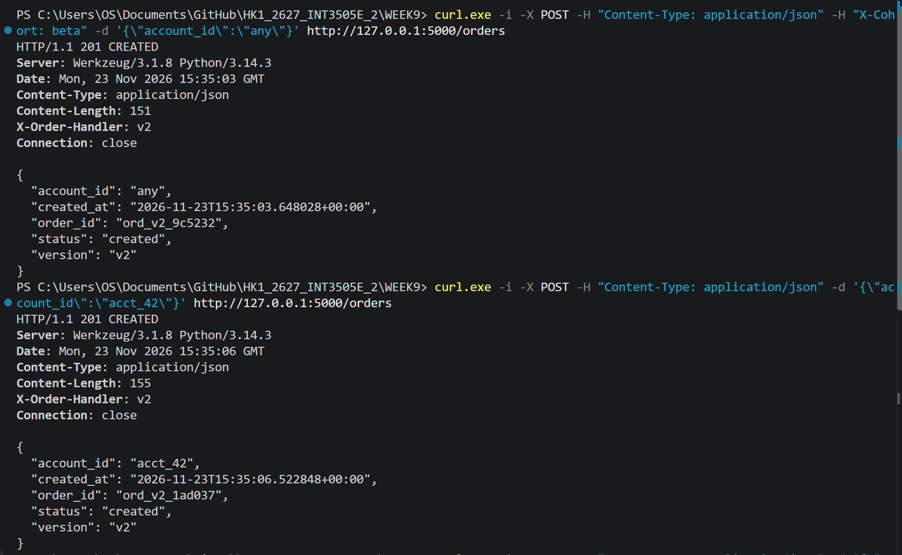
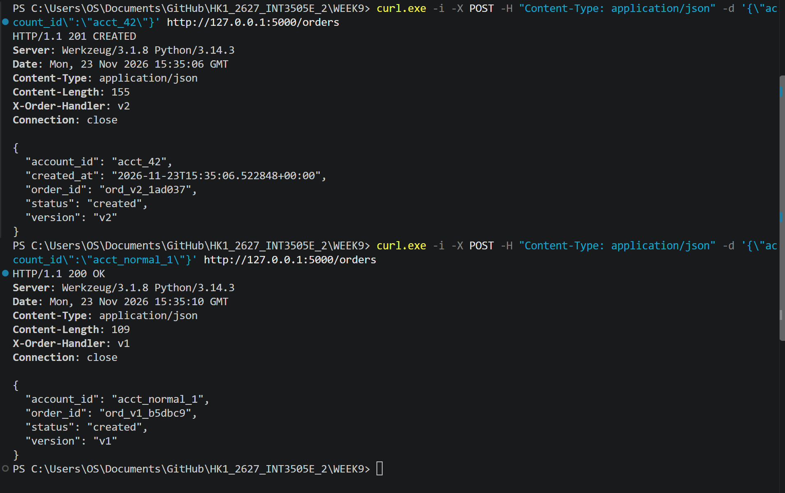

# LAB4: Blue-Green Routing (1 URL — Chọn v1 hoặc v2 theo Cohort)

## 1. Hướng dẫn chạy ứng dụng

### Yêu cầu môi trường
- Python 3.x
- Thư viện `Flask`

### Khởi chạy server
```powershell
pip install flask
python app.py
```
Server sẽ lắng nghe tại địa chỉ: `http://127.0.0.1:5000`

---

## 2. Kết quả kiểm thử (Test Cases)

Dưới đây là kết quả kiểm thử thực tế bằng `curl.exe` trên PowerShell với cấu hình mặc định `V2_PERCENT = 5`.

### Case 1: Điều hướng theo Header `X-Cohort: beta` $\rightarrow$ `v2`
Request với tài khoản bất kỳ (`any`) nhưng có gắn header `X-Cohort: beta`.

**Lệnh thực thi:**
```powershell
curl.exe -i -X POST -H "Content-Type: application/json" -H "X-Cohort: beta" -d '{\"account_id\":\"any\"}' http://127.0.0.1:5000/orders
```

**Kết quả trả về:**
- **Status Code:** `HTTP/1.1 201 CREATED`
- **Response Header:** `X-Order-Handler: v2`
- **Response Body:**
```json
{
  "account_id": "any",
  "created_at": "2026-11-23T15:35:03.648028+00:00",
  "order_id": "ord_v2_9c5232",
  "status": "created",
  "version": "v2"
}
```


---

### Case 2: Điều hướng theo Account Allow-list (`acct_42`) $\rightarrow$ `v2`
Request không có header `X-Cohort`, nhưng `account_id` là `acct_42` thuộc danh sách `V2_FORCE_ACCOUNTS`.

**Lệnh thực thi:**
```powershell
curl.exe -i -X POST -H "Content-Type: application/json" -d '{\"account_id\":\"acct_42\"}' http://127.0.0.1:5000/orders
```

**Kết quả trả về:**
- **Status Code:** `HTTP/1.1 201 CREATED`
- **Response Header:** `X-Order-Handler: v2`
- **Response Body:**
```json
{
  "account_id": "acct_42",
  "created_at": "2026-11-23T15:35:06.522848+00:00",
  "order_id": "ord_v2_1ad037",
  "status": "created",
  "version": "v2"
}
```


---

### Case 3: Tài khoản thường (`acct_normal_1`) với `V2_PERCENT = 5` $\rightarrow$ `v1`
Request không có header cohort và không thuộc allow-list; giá trị hash bucket rơi ngoài ngưỡng 5% nên được điều hướng về `v1`.

**Lệnh thực thi:**
```powershell
curl.exe -i -X POST -H "Content-Type: application/json" -d '{\"account_id\":\"acct_normal_1\"}' http://127.0.0.1:5000/orders
```

**Kết quả trả về:**
- **Status Code:** `HTTP/1.1 200 OK`
- **Response Header:** `X-Order-Handler: v1`
- **Response Body:**
```json
{
  "account_id": "acct_normal_1",
  "order_id": "ord_v1_b5dbc9",
  "status": "created",
  "version": "v1"
}
```


---

### Tổng hợp kết quả

| Test Case | Input (`Header` / `account_id`) | HTTP Status | Header `X-Order-Handler` | Kết luận |
| :--- | :--- | :---: | :---: | :--- |
| **Case 1 (Cohort)** | `X-Cohort: beta`, `any` | `201 CREATED` | `v2` | Đạt (ưu tiên tầng 1) |
| **Case 2 (Allow-list)** | `acct_42` | `201 CREATED` | `v2` | Đạt (ưu tiên tầng 2) |
| **Case 3 (Hash Bucket 5%)** | `acct_normal_1` | `200 OK` | `v1` | Đạt (ưu tiên tầng 3) |

### Ảnh chụp minh họa
> *(Thay đường dẫn bên dưới bằng tên file ảnh thực tế trong repo của bạn)*
>
> 
> 

---
